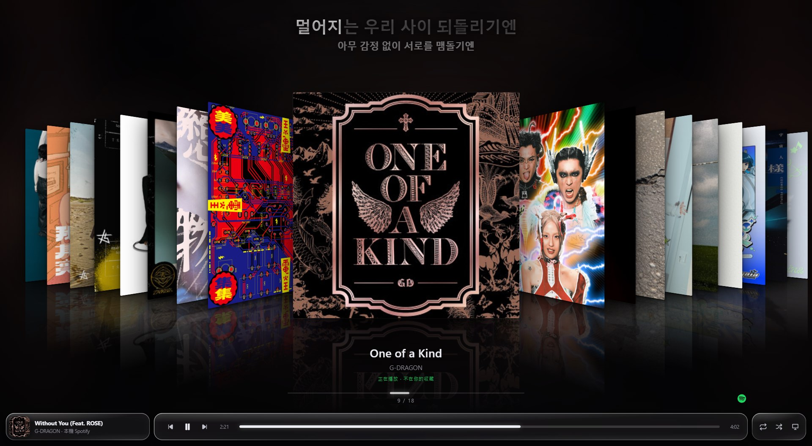

# VitroDeck

**讓 Spotify 變成一整面封面牆**

把收藏的專輯排成可以滑過去的 3D 封面流,配上逐句同步歌詞與 KTV 提詞。 
音樂還是由 Spotify 播 —— VitroDeck 只負責讓它好看。

[**下載最新版**](../../releases/latest) · [使用說明](https://vitrodeck.shdf.work/) · [回報問題](../../issues)

---

## 需要什麼

| | |
|---|---|
| **Windows 10 / 11** | 需要 WebView2 執行階段(現代 Windows 都內建) |
| **Spotify Premium** | 播放控制的 API 對免費帳號一律回 403 |
| **Spotify 桌面版** | 音樂由它播放,VitroDeck 讀取並控制它 |
| **一組自己的 Client ID** | 三分鐘申請,程式內有精靈帶你走 |

免安裝,單一執行檔。設定與快取存在 exe 旁邊,搬移時整個資料夾一起搬。

> 第一次執行 Windows SmartScreen 可能會跳警告,
> 按「其他資訊 → 仍要執行」即可。

---

## 功能

**封面流** — 方向鍵或滾輪滑過去,兩側封面帶透視傾斜與倒影。正在播的專輯自動置中;
不在收藏裡的話會臨時插進來,左右滑開讓位。

**同步歌詞** — 大字歌詞跟著唱到的句子走,點任一句跳到該時間點。時間對不上可以微調,調完記住。

**KTV 提詞** — 封面流上方顯示當前句與下一句,唱過的字逐漸填白。

**鍵盤為主** — 翻頁、播放、搜尋、排序、調整封面大小都有快捷鍵,按 `?` 叫出對照表。

快捷鍵一覽

| 鍵 | 作用 |
|---|---|
| `←` `→` | 翻封面 |
| `PgUp` `PgDn` | 一次 10 張 |
| `Home` `End` | 頭 / 尾 |
| `A`–`Z` | 跳到該字母開頭的演出者或專輯 |
| `Enter` | 播放目前這張專輯 |
| `空白鍵` | 播放 / 暫停 |
| `↑` `↓` | 上一首 / 下一首 |
| `Tab` / `L` | 封面流 ⇄ 歌詞視圖 |
| `/` | 搜尋 |
| `S` | 切換排序 |
| `R` | 重抓收藏 |
| `D` | 選擇播放裝置 |
| `K` | KTV 提詞開關 |
| `E` `X` | 重複 / 隨機播放 |
| `[` `]` `0` | 歌詞時間微調 / 歸零 |
| `-` `=` `\` | 封面縮小 / 放大 / 還原 |
| `F11` | 全螢幕 |
| `I` | 關於 / 中斷 Spotify 連結 |
| `Esc` `Q` | 退回一步 / 關閉程式 |

---

## 運作方式

播放狀態的主要來源是 **SMTC**(Windows 系統媒體傳輸控制),不是 Spotify Web API。

Web API 有請求配額,穩定輪詢會被鎖上數小時(實測 `Retry-After` 給過 14165 秒)。
SMTC 是本機介面,免費、無配額、讀一次約 0.3 毫秒,所以可以打得很密,反應比輪詢 API 更即時。

| 資料 | 來源 |
|---|---|
| 曲名 / 演出者 / 專輯名 / 進度 / 播放狀態 / 隨機 / 重複 | SMTC |
| 播放控制(上下首、播放暫停、跳轉、隨機、重複) | SMTC |
| 收藏專輯清單 | Spotify Web API,快取到磁碟,按 `R` 才更新 |
| 專輯 URI 與 640px 封面 | 先比對收藏清單(0 次請求),比對不到才搜尋(每張專輯一次,永久存檔) |
| 播放指定專輯 / 裝置清單 | Spotify Web API(使用者觸發) |
| 遠端裝置的播放狀態 | Spotify Web API —— SMTC 只看得到本機 |
| 歌詞 | 社群歌詞庫,以演出者 + 曲名查詢 |

穩定聽歌時 Web API 的請求數趨近於零。

**SMTC 不提供任何 Spotify ID**,所以要用「專輯名 + 演出者」回頭比對收藏清單。
`(Deluxe)`、`- Remastered`、`（豪華版）`、`[Live]` 這類後綴會先正規化再比對。
它的封面縮圖也只有 300×300,所以比對到收藏就改用快取的 640px。

---

## 已知限制

- **只讀收藏的專輯**(按過愛心的)。歌單、單曲、Podcast 沒做。
- **沒有收藏(愛心)功能。** Spotify 對開發者模式的應用程式擋掉了音樂庫的
  `/me/tracks/contains` 與 `PUT /me/tracks`(一律 403),所以查詢與加入收藏都做不到。
- **僅 Windows。** SMTC 是 Windows 專有介面。
- 沒有播放裝置時第一次按 `Enter` 會失敗 —— 先在 Spotify 隨便播一首,或按 `D` 手動選。
- 冷門曲目可能沒有歌詞,或只有沒有時間軸的純文字;那種情況不顯示 KTV 提詞。
- KTV 的逐字填色**預設是整句平均推進**,不是真的逐字對齊 —— 一般歌詞庫只提供行級時間戳。

---

## 隱私

授權權杖、收藏快取、歌詞全部只存在你自己的電腦上。VitroDeck **沒有任何自己的伺服器**,
不收集、不上傳任何資料。

程式內按 `I` 可以隨時**中斷 Spotify 連結並刪除所有本機資料**。
也可以到 [Spotify 帳號頁面](https://www.spotify.com/account/apps/)移除授權。

---

## 免責聲明

VitroDeck 是第三方獨立程式,**與 Spotify AB 無關聯,亦未經其認可或贊助**。
Spotify 是 Spotify AB 的商標。

專輯名稱、演出者與封面圖片由 Spotify Web API 提供;歌詞由社群歌詞庫提供,
其著作權屬於各自權利人。使用本程式需要有效的 Spotify Premium 訂閱。
